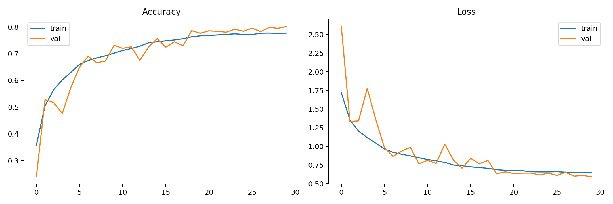
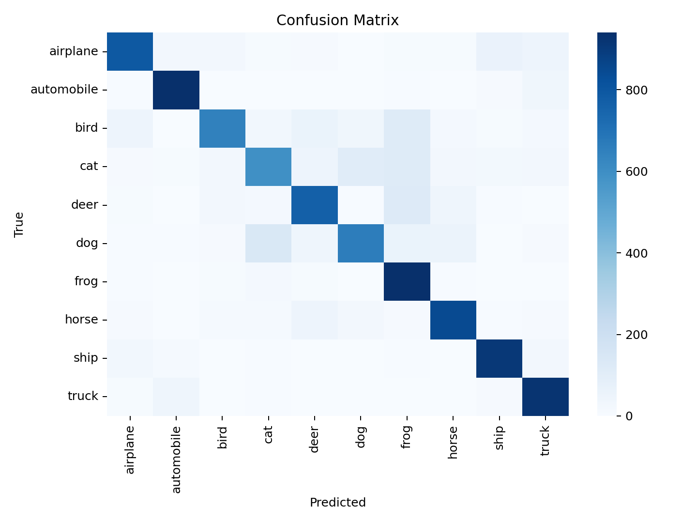
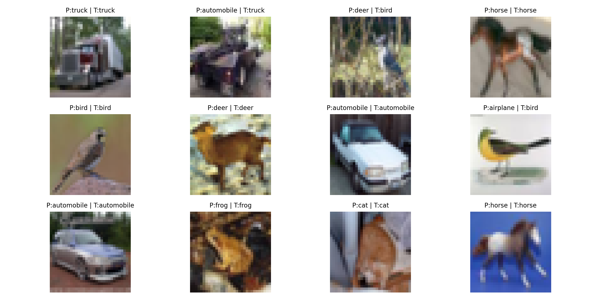

# Image Classification with a CNN (CIFAR-10)

[](https://colab.research.google.com/github/seiifff/image-classification-cnn-cifar10/blob/main/cifar10_cnn.ipynb)


A convolutional neural network built with TensorFlow/Keras that classifies 32×32 images from the CIFAR-10 dataset into 10 classes (airplane, automobile, bird, cat, deer, dog, frog, horse, ship, truck).

**Result: ~80% test accuracy** (0.8015 on the 10,000-image test set; varies slightly by seed).

## Approach

- **Model:** stacked Conv2D blocks with Batch Normalization and Dropout, then a dense classifier
- **Augmentation:** random horizontal flip, rotation and zoom (Keras preprocessing layers)
- **Training:** Adam (learning rate 1e-3) with EarlyStopping, ReduceLROnPlateau and ModelCheckpoint
- **Evaluation:** test accuracy, per-class classification report, confusion matrix and sample predictions

## Results

| Learning curves | Confusion matrix |
|---|---|
|  |  |



## Run it

Open the notebook in Colab with the badge above, or run locally:

```bash
pip install -r requirements.txt
jupyter notebook cifar10_cnn.ipynb
```

The trained model is saved as `cnn_cifar10.keras` and can be loaded with `tf.keras.models.load_model("cnn_cifar10.keras")`.
